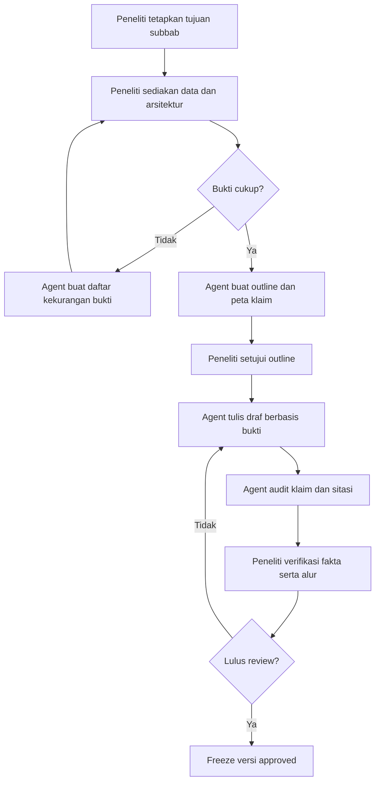

# 9. Protokol agentic drafting dan review

## 9.1. Workflow per subbab



## 9.2. Kontrak input agent (salin tiap kali drafting)

```yaml
role: academic_drafting_agent
chapter_section: "[contoh: 4.1.2 Data Modeling]"
research_question: "[RQ yang didukung]"
section_purpose: "[apa yang harus dipahami pembaca]"
source_of_truth:
  - "[nama file data + versi]"
  - "[arsitektur + versi]"
  - "[tabel hasil + lokasi]"
  - "[referensi primer tervalidasi]"
implemented_steps:
  - "[langkah yang sudah benar-benar dilakukan]"
required_claims:
  - "[klaim + evidence_id]"
prohibited_claims:
  - "Tidak mengarang hasil, parameter, sitasi, wawancara, atau angka"
  - "Tidak menulis hasil eksperimen yang belum selesai sebagai fakta"
  - "Tidak mengubah rancangan riset tanpa permintaan peneliti"
style: "Bahasa Indonesia akademik, alami, ringkas, koheren"
output:
  - "outline_alur"
  - "draft_paragraf"
  - "claim_evidence_table"
  - "missing_evidence"
  - "review_questions"
```

## 9.3. Prompt standar untuk agent

> [!example] Prompt siap pakai
> Kamu membantu **drafting skripsi**, bukan menentukan atau mengarang fakta penelitian. Kerjakan subbab `[NOMOR — JUDUL]` menggunakan hanya dokumen input terlampir. Sebelum menulis, buat (1) tujuan subbab, (2) alur penalaran antarparagraf, (3) tabel klaim–bukti–file sumber, dan (4) daftar kekurangan data. Jika bukti cukup, tulis draf dalam bahasa Indonesia akademik yang alami. Pisahkan **metode yang direncanakan**, **implementasi yang telah dikerjakan**, **hasil terukur**, dan **interpretasi**. Tandai klaim tanpa bukti sebagai `[BUTUH BUKTI: ...]`, jangan mengisinya sendiri. Jangan menambahkan sitasi yang tidak ada di referensi terverifikasi. Akhiri dengan checklist audit kesesuaian Bab III–IV dan pertanyaan untuk peneliti.

## 9.4. Peran beberapa agent (opsional)

- [ ] **Research librarian**: memeriksa paper, membuat matriks sumber, memvalidasi bibliografi; tidak membuat referensi fiktif.
- [ ] **Data auditor**: memeriksa dataset, split, missing, duplikat, leakage dan provenance.
- [ ] **Experiment engineer**: menyiapkan kode, logging, re-run dan rekap metrik dari data asli.
- [ ] **Methodology reviewer**: menguji apakah rancangan menjawab RQ serta sebanding antar eksperimen.
- [ ] **Academic writer**: menulis sesuai outline dan evidence yang disetujui.
- [ ] **Critical reviewer**: memeriksa klaim, alur, sumber, kesesuaian antar bab, dan potensi overclaim.

> [!warning] Persetujuan manusia
> Agent boleh mengusulkan perbaikan desain, tetapi **peneliti yang memutuskan** sampling, pemilihan metode, perubahan eksperimen, interpretasi statistik, dan klaim akhir.

## 9.5. Checklist review keluaran agent

- [ ] Saya dapat menjelaskan semua istilah teknis dalam paragraf tanpa bantuan agent.
- [ ] Semua nama dataset/kolom/metode benar-benar ada.
- [ ] Semua angka cocok dengan artefak dan rumus.
- [ ] Semua paragraf memiliki fungsi logis, bukan sekadar panjang.
- [ ] Setiap perpindahan paragraf memiliki penghubung argumentatif.
- [ ] Ada perbedaan jelas antara deskripsi hasil dan analisis hasil.
- [ ] Tidak ada hasil test yang dipakai untuk memilih parameter model.
- [ ] Setiap sitasi sudah dicocokkan dengan artikel aslinya.
- [ ] Draf sesuai subbab sebelum dan sesudahnya; tidak mengulang informasi tanpa tujuan.
- [ ] Saya sanggup mempertahankan metode dan interpretasi saat ditanya pembimbing/penguji.

---
